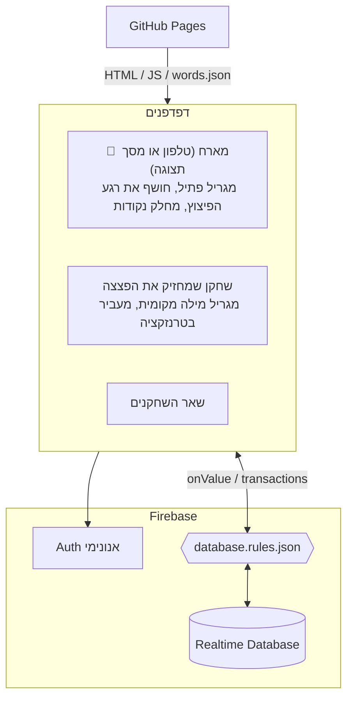

<div align="center">

# מילה-פצצה 💣

**משחק מסיבות לטלפון: מסבירים מילה לקבוצה, מעבירים את הפצצה, ומקווים שהיא לא תתפוצץ אצלכם.**

[**▶ לשחק עכשיו**](https://arielhone.github.io/bomb-word/) · [מהלך המשחק](#מהלך-המשחק) · [ארכיטקטורה](#ארכיטקטורה) · [עדכון ופריסה](#עדכון-ופריסה) · [בדיקות](#פיתוח-ובדיקות)


-success)

</div>

---

## על המשחק

שתי קבוצות, טלפון לכל שחקן, וכולם באותו חדר. מי שמחזיק את הפצצה רואה מילה בטלפון ומסביר אותה לקבוצה שלו. כשהקבוצה מנחשת, הוא לוחץ "נוחש!" והפצצה עוברת לקבוצה היריבה. אף אחד לא יודע מתי היא תתפוצץ.

- **בלי התקנה:** נכנסים מהדפדפן בטלפון עם קוד בן 4 אותיות או QR.
- **4 שחקנים ומעלה**, לפחות 2 בכל קבוצה. יש 379 מילים ב-7 קטגוריות.
- **מסך תצוגה** ללפטופ או לטלוויזיה, עם ניקוד גדול ושם מי שמחזיק את הפצצה.
- **פיצוץ מסונכרן:** צליל, רטט והבזק בכל הטלפונים באותו רגע, לפי שעון השרת.
- **הוגן:** השרת אוכף מי מעביר למי ומתי, ואי אפשר לגלות את הזמן או את המילה מטלפון אחר.

---

## מהלך המשחק

1. **פתיחת חדר:** המארח פותח חדר ומקבל קוד ו-QR, והשחקנים נכנסים עם שם. אפשר לפתוח את החדר גם **ממסך תצוגה**: המסך הוא המארח ולא משחק בעצמו.
2. **קבוצות:** המארח לוחץ "🔀 ערבב קבוצות", גורר שחקנים בין העמודות, או מקיש על שחקן כדי להעביר אותו לקבוצה השנייה. כל שחקן לוחץ "🔊 אני מוכן", כדי להפעיל צליל ולמנוע מהמסך להיכבות.
3. **סבב:** מילה אקראית מופיעה **רק** בטלפון של מי שמחזיק את הפצצה. כשהקבוצה שלו מנחשת, הוא לוחץ **"✅ נוחש!"**, והפצצה עוברת, עם מילה חדשה, לשחקן הבא **מהקבוצה היריבה**. "⏭ דלג" מחליף מילה בלי להעביר את הפצצה.
4. **פתיל נסתר:** הזמן מוגרל בתוך הטווח שהמארח בחר, ואף אחד לא רואה כמה נשאר. התקתוק מאיץ ככל שהסבב נמשך.
5. **💥 בום:** בכל הטלפונים בבת אחת יש צליל פיצוץ, רטט והבזק אדום. **הקבוצה היריבה** לזו שהחזיקה את הפצצה מקבלת נקודה.
6. **תוצאות:** המילה שהתפוצצה, כל המילים שנוחשו בסבב ומי הסביר כל אחת, וטבלת הניקוד. הקבוצה הראשונה שמגיעה ליעד מנצחת. "🔁 משחק חדש" מאפס את הניקוד.

### הגדרות המארח (בלובי)

| הגדרה | אפשרויות | ברירת מחדל |
|---|---|---|
| 🏁 משחק עד | 5, 7, 10, 15 נקודות | 7 |
| ⏱️ אורך פתיל | ⚡ קצר 20–45 שניות · רגיל 40–90 · ארוך 60–120 · 🐢 ארוך מאוד 90–180 | רגיל |
| 🗂️ קטגוריות | חפצים, מקומות, מקצועות, אוכל, סלנג ישראלי, ספורט, פרסונות מוכרות | הכל |
| 🚫 ערעור על "נוחש!" | כבוי / פעיל | כבוי |

**אורך הפתיל:** ככל שיש יותר שחקנים, כדאי טווח ארוך יותר, כדי שהפצצה תספיק לעבור בין כולם. מתחת לבחירה מופיעה המלצה לפי מספר השחקנים בחדר. את ההגדרות משנים רק בלובי, ומסך התוצאות מחזיר ללובי בלחיצה על "⚙️ חזרה ללובי".

### סדר התורות

כל קבוצה מתקדמת בסבב משלה, והתורות מתחלפים בין הקבוצות: א1, ב1, א2, ב2... גם הקבוצה שפותחת את הסבב מתחלפת בכל סבב. שחקן מנותק מדולג. מי שמצטרף באמצע משחק משובץ אוטומטית לקבוצה הקטנה מבין השחקנים המחוברים.

### נגד רמאות

אי אפשר לבדוק בקוד אם הקבוצה באמת ניחשה, כי הניחוש נאמר בקול. לכן הרמאות נעשית גלויה:

- **תמיד:** אחרי כל "נוחש!", כל הטלפונים ומסך התצוגה מציגים לשלוש שניות באנר כמו "✅ נוחש: פלאפל". הקבוצה היריבה שומעת מה נאמר בחדר, אז מי שלוחץ "נוחש!" בלי שניחשו נחשף מיד.
- **ערעור (אופציונלי):** במשך 5 שניות אחרי "נוחש!", כל שחקן מהקבוצה שקיבלה את הפצצה יכול ללחוץ "🚫 לא נוחש!". הפצצה חוזרת למי שהעביר, עם מילה חדשה, והמילה מופיעה מחוקה ברשימה. מותר ערעור אחד לכל קבוצה בכל סבב.

---

## ארכיטקטורה

אין שרת משלנו. Realtime Database משמש בבת אחת כמסד הנתונים, כערוץ הסנכרון וכשכבת ההרשאות.



**הדפדפן של המארח הוא השופט.** אם המארח נעלם, השחקן המחובר הוותיק ביותר לוקח את התפקיד אחרי 4 שניות. מארח שיוצא בכפתור 🚪 מעביר את התפקיד מיד.

### מבנה הנתונים

```
rooms/{CODE}
  meta      { hostUid, phase: lobby|playing|results|over, target, cats{}, fuseMin, fuseMax,
              appeal, point{round,team}, createdAt }
  players/{uid}  { name, team: A|B, order, joinedAt, online, ready, spectator? }
  scores    { A, B }
  game      { round, startedAt, startTeam, holder, team, seq, ptr{A,B}, passedAt,
              last{by, w?, appeal?, against?, ptr}, log{s1:{w,by,t,x?}}, appealed{A?,B?},
              explodeAt?, boom{holder,team,at}?, word? }
  used/{wordKey}: true          מילים שכבר יצאו בחדר (רק המפתח, לא המילה)
fuses/{CODE}  { round, ms }     הפתיל הסודי. אף לקוח לא יכול לקרוא אותו
```

### סנכרון הפיצוץ

- **שעון:** כל הזמנים נשמרים בשעון השרת (`ServerValue.TIMESTAMP`). כל לקוח מתקן את השעון שלו לפי `.info/serverTimeOffset`, ולכן לא סומכים על השעון של אף טלפון.
- **הסוד:** אורך הפתיל נשמר ב-`fuses/{CODE}`, שנעול לקריאה. **3 שניות לפני הסוף** המארח כותב את `game.explodeAt`, וכל הטלפונים מתזמנים את הפיצוץ לאותו רגע בשעון השרת. בבדיקות עם 5 טאבים, הפער בין המסכים היה 5–30ms ב-Chromium ועד 160ms ב-WebKit.
- **התקתוק:** הקצב מחושב לפי הזמן **שעבר** מתחילת הסבב, ביחס לטווח שנבחר, ולא לפי הזמן שנשאר. כך הוא לא מסגיר את הפתיל. ב-3 השניות האחרונות הוא קופץ לקצב מטורף.
- **גיבוי:** אם המארח לא מחובר, כל שחקן מנסה לרשום את הפיצוץ. ה-rules מאשרים את הרישום רק אחרי שהפתיל **באמת** נגמר, כי הם יכולים לקרוא את `fuses` גם כשהלקוח לא יכול. מארח שמרענן את הדף זוכר את הפתיל (localStorage), ולכן הפיצוץ נשאר מסונכרן.

### העברת הפצצה

`runTransaction` על `game`. הטרנזקציה בודקת שאני המחזיק ושה-`seq` לא השתנה, ולכן לחיצה כפולה על "נוחש!" מעבירה פעם אחת בלבד. גם השרת אוכף את זה:

| כלל | למה |
|---|---|
| רק המחזיק (או המארח) מעביר | אי אפשר לחטוף את הפצצה |
| `seq` עולה ב-1 בדיוק | לחיצה כפולה או בקשה ישנה נדחות |
| רק לשחקן מהקבוצה היריבה | אי אפשר להעביר לחבר לקבוצה |
| רק לפני שהפתיל נגמר | מסירה "ברגע האחרון" שהגיעה לשרת אחרי הפיצוץ נדחית |
| המחזיק לא יכול לזייף מי העביר, או לאפס ערעורים | הבאנר "נוחש" וחלון הערעור אמינים |
| ערעור: רק כשהאופציה פעילה, רק מהקבוצה שקיבלה, תוך 5 שניות (ועוד שנייה חסד), פעם אחת לקבוצה בסבב, והפצצה חוזרת רק למי שהעביר | אי אפשר לערער סתם, שוב ושוב, או "לשלוח" את הפצצה למישהו אחר |

**ניתוק:** הנוכחות מנוהלת עם `onDisconnect`. אם המחזיק סוגר את הטאב או מאבד חיבור, המארח מעביר את הפצצה לבא בתור אחרי 3 שניות. ההמתנה הקצרה מונעת העברה כשמישהו רק מרענן. מעבר כזה מוצג לכולם, ואי אפשר לערער עליו.

### מודל אבטחה ([`database.rules.json`](database.rules.json))

- כל שחקן כותב רק את הרשומה של עצמו, ולא יכול לשנות לעצמו קבוצה או ניקוד.
- רק המארח משנה שלבים, הגדרות, ניקוד וקבוצות, ורק הוא מוחק את החדר.
- יוצרים חדר רק בקוד פנוי, ואי אפשר לדרוס חדר קיים.
- הפתיל חייב להיות בתוך הטווח של החדר, ובכל מקרה בין 15 ל-180 שניות.
- המילה עצמה לא נשמרת ב-DB בזמן שמסבירים אותה. היא מוגרלת בטלפון של המחזיק, ונחשפת רק אחרי "נוחש!" או אחרי הפיצוץ.

> [!NOTE]
> **מגבלות ידועות**
> - המארח מגריל את הפתיל, ולכן מארח שמשתמש ב-DevTools יכול לדעת מתי יהיה הפיצוץ. בין חברים זה בסדר. הגנה מלאה דורשת Cloud Functions, שמחייבות את תוכנית Blaze.
> - חדרים לא נמחקים אוטומטית, כי ב-Realtime Database אין TTL. חדר נמחק כשהאחרון יוצא בכפתור 🚪. חדר שכולם פשוט סגרו בו את הטלפון נשאר במסד, וכל אחד כזה תופס כמה KB.

### אייפון

- **רטט:** אין רטט ב-Safari, ולכן באייפון מופיע במקומו **הבזק חזק**, מסך מלא שמהבהב לבן ואדום.
- **צליל:** הצליל מופעל רק אחרי לחיצה של המשתמש ("אני מוכן"), כמו שהדפדפן באייפון דורש. אחרי רענון באמצע סבב מופיע מסך "אני מוכן" שחוסם את המשחק. הוא מופיע פעם אחת בלבד, כך ששחקן לא נתקע גם אם הצליל לא עלה.
- **מסך דולק:** Wake Lock מבקש שהמסך לא ייכבה באמצע סבב, ומבקש שוב כשחוזרים לטאב.
- **מה נבדק:** המשחק נבדק ב-WebKit (המנוע של Safari) עם הדמיית אייפון, **עדיין לא באייפון אמיתי**. לא נבדקו הצליל בפועל ומתג השקט. כשמתג השקט דלוק, ייתכן שלא יהיה צליל.

---

## עדכון ופריסה

הפרויקט מחובר ל-Firebase `bomb-word-af859`, והאתר מתארח ב-GitHub Pages מענף `main`.

| מה השתנה | מה עושים |
|---|---|
| קוד, עיצוב או מילים | `git push`. האתר מתעדכן אחרי כדקה |
| כללי אבטחה (`database.rules.json`) | `firebase deploy --only database`, **וגם** `git push`. בלי ה-deploy, השרת ממשיך לאכוף את הכללים הישנים |

> [!IMPORTANT]
> שינוי בקוד שדורש גם שינוי ב-rules (למשל שדה חדש או טווח חדש) לא יעבוד באתר עד שמריצים `firebase deploy --only database`.

<details>
<summary><b>הקמה מאפס בפרויקט Firebase אחר</b></summary>

1. [Firebase Console](https://console.firebase.google.com) ← **Add project**. אין צורך ב-Google Analytics, והתוכנית החינמית Spark מספיקה.
2. **Authentication** ← Sign-in method ← **Anonymous** ← Enable. מומלץ לסמן גם Auto clean-up.
3. **Realtime Database** ← Create database ← `europe-west1` ← **Locked mode**.
4. **Project settings** ← Your apps ← **`</>` Web app**, בלי Firebase Hosting ← להעתיק את `firebaseConfig` אל [`firebase-config.js`](firebase-config.js). חשוב שיהיה בו גם `databaseURL`.
5. לעדכן את מזהה הפרויקט ב-[`.firebaserc`](.firebaserc), ולפרוס את כללי האבטחה:

```bash
npm i -g firebase-tools
firebase login
firebase deploy --only database
```

6. GitHub ← **Settings → Pages** ← *Deploy from a branch* ← `main` / `(root)`.

אין צורך להוסיף את הדומיין של GitHub Pages ל-Authorized domains. ההגדרה הזו חלה על התחברות עם Google ודומיה, לא על התחברות אנונימית.

> `apiKey` שב-`firebase-config.js` אינו סוד, הוא רק מזהה את הפרויקט. מה שמגן על הנתונים הם ה-rules.

</details>

---

## פיתוח ובדיקות

### הרצה מקומית מול האמולטור (דורש Java)

האמולטור לא נוגע בפרויקט האמיתי:

```bash
firebase emulators:start --only auth,database --project demo-bomb-word
python -m http.server 8123          # בטרמינל נוסף, מתוך תיקיית הפרויקט
```

פותחים את `http://127.0.0.1:8123`. מ-localhost המשחק מתחבר לאמולטור אוטומטית. כדי לעבוד מ-localhost מול הפרויקט האמיתי, מוסיפים `?live=1`.

> [!TIP]
> אם מופיעה השגיאה `port taken`, נשאר תהליך Java של אמולטור קודם שרץ ברקע. ב-PowerShell:
> `Get-NetTCPConnection -LocalPort 9000 | % { Stop-Process -Id $_.OwningProcess -Force }`

### בדיקה עם כמה "שחקנים" על מחשב אחד

כל **פרופיל דפדפן** מקבל משתמש אנונימי משלו. טאבים באותו חלון **חולקים** משתמש, ולכן ייחשבו לאותו שחקן.

| שחקן | איך |
|---|---|
| מסך תצוגה / מארח | חלון Chrome רגיל ← "📺 פתח חדר ממסך תצוגה" |
| שחקן 1 | חלון גלישה בסתר של Chrome (Ctrl+Shift+N) |
| שחקן 2 | Edge, או חלון InPrivate שלו |
| שחקן 3 | Firefox, או חלון פרטי שלו |
| שחקן 4 | פרופיל Chrome נוסף (סמל הפרופיל ← Add) |

> חלונות הגלישה בסתר של אותו דפדפן חולקים ביניהם מצב אחד, אז לכל שחקן נוסף צריך דפדפן או פרופיל אחר. הכי פשוט לבדוק באתר עצמו, עם כמה טלפונים אמיתיים.

**תרחיש בדיקה מומלץ:**

1. **פתיחה:** במסך התצוגה פותחים חדר. בכל חלון שחקן מקלידים קוד ושם ולוחצים "אני מוכן".
2. **הגדרות:** במסך בוחרים ⏱️ "קצר" (כדי לא לחכות), מפעילים "ערעור", ולוחצים "🔀 ערבב קבוצות".
3. **התחלה:** לוחצים "💣 התחל משחק". **רק** בחלון אחד אמורה להופיע מילה.
4. **לחיצה כפולה:** לוחצים "נוחש!" פעמיים מהר. הפצצה עוברת פעם אחת בלבד, וכל החלונות מציגים "✅ נוחש: …".
5. **ערעור:** בקבוצה שקיבלה לוחצים "🚫 לא נוחש!". הפצצה חוזרת למי שהעביר. הכפתור נעלם אחרי 5 שניות.
6. **ניתוק:** **סוגרים** את החלון של מי שמחזיק את הפצצה. אחרי כ-3 שניות היא עוברת לבא בתור.
7. **פיצוץ:** מחכים לפיצוץ. יש הבזק וצליל בכל החלונות יחד, ואז התוצאות עם רשימת המילים ו-+1 לקבוצה היריבה.
8. **החלפת מארח:** סוגרים את מסך התצוגה באמצע סבב. אחרי כ-4 שניות שחקן אחר מקבל 👑, והסבב מסתיים כרגיל.

### בדיקות ל-rules

[`tests/rules.test.js`](tests/rules.test.js) מריץ 25 בדיקות ל-`database.rules.json` מול אמולטור. הן בודקות העברה, פיצוץ, ערעור, טווח פתיל, הרשאות וחדרים. דורש Java, ולא נוגע בפרויקט האמיתי.

```bash
cd tests
npm install
npm test
```

כדאי להריץ אחרי כל שינוי ב-`database.rules.json`, לפני `firebase deploy --only database`.

---

## מבנה הפרויקט

```
bomb-word/
├── index.html            מעטפת הדף
├── app.js                כל הלוגיקה, המצב והמסכים
├── audio.js              צלילים עם Web Audio (תקתוק, "נוחש!", ערעור, פיצוץ)
├── fx.js                 Wake Lock, רטט, הבזק מסך
├── style.css             עיצוב (mobile-first, RTL, מסך תצוגה רחב)
├── words.json            379 מילים ב-7 קטגוריות
├── firebase-config.js    פרטי החיבור לפרויקט Firebase
├── database.rules.json   כללי אבטחה
├── firebase.json         פריסת rules והגדרות אמולטור
├── .firebaserc           מזהה הפרויקט
└── tests/                בדיקות ל-rules (npm test)
```

### הוספת מילים

ב-[`words.json`](words.json) כל קטגוריה בנויה כך: `{ "id", "name", "emoji", "words": [...] }`. אפשר להוסיף מילים לקטגוריה קיימת או ליצור קטגוריה חדשה, והיא תופיע אוטומטית בבחירת הקטגוריות בלובי.

> [!WARNING]
> מוסיפים מילים **רק בסוף** הרשימה, ולא מוחקים או מזיזים מילים קיימות. המפתח של כל מילה הוא המיקום שלה בקטגוריה (`food_12`), ושינוי בסדר יבלבל את רשימת "מילים שכבר יצאו" בחדרים פעילים.

---

## רעיונות להמשך

- [ ] שורה אחת שתאפשר צליל גם כשמתג השקט באייפון דלוק (`navigator.audioSession.type = "playback"`)
- [ ] בדיקה על אייפון אמיתי
- [ ] קטגוריות נוספות, או מילים משלכם שהמארח מקליד
- [ ] ניקוד אישי: מי הסביר הכי הרבה מילים במשחק
